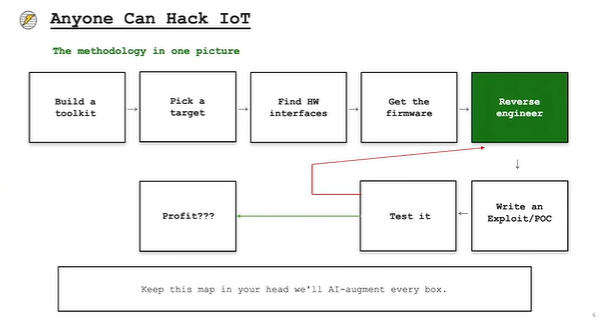

**미션 목표** 
DEFCONConference, blackhat 등 해외 유명한 컨퍼런스의 영상을 보고 리뷰를 작성한다. 리뷰는 자신만의 스타일을 살려 작성한다.

****
# 개요
이번 리뷰에서 볼 영상은 다음과 같다.

DEF CON 34 - IoT - 누구나 할 수 있는 IoT 해킹 - AI 기반 IoT 해킹 입문 가이드 - Andrew Bellini
https://www.youtube.com/watch?v=N1hXKLAQh8k&list=LL&index=6

해당 주제를 고른 이유는 이전에 IoT를 학습하고 직접 취약점을 분석하는 과정이 흥미로웠었다. 그래서 본격적으로 하드웨어 해킹을 시작해보자 하는 마음과 전문가는 어떻게 분석을 진행하는지 알아보고자 해당 영상을 선택하였다.

# 요약
AI로 인해 저가형 IoT 기기의 고질적인 보안 취약점과 MCP와 결합한 자동화의 결합으로 IoT 해킹의 진입 장벽이 크게 낮아졌다.
# 전체 내용

하드웨어 해킹의 전반적인 순서는 다음과 같다.

1. 대상을 정하는 게 우선
2. 장치에서 하드웨어 인터페이스를 찾고 어떻게 악용할 수 있는지 살피기
3. 가장 중요한 펌웨어를 획득하는 것 + 리버싱
4. PoC 작성 및 작동 확인
5. 1~4 반복

하지만 하드웨어 해킹을 하기 전에 필요한 도구 3가지가 있다. 
멀티미터, USB to UART, 플래시 메모리 프로그래머(펌웨어 추출을 할 수 있는 능력)가 필요하다. 

대상은 RTOS, 베어 메탈 마이크로 컨트롤러는 어려워서 처음에 하기엔 비추하고 대신 저렴한 스마트 카메라나 라우터를 먼저 해보는 것을 추천한다. 하드웨어는 가격만큼의 성능을 하는만큼 저렴한 기기에는 취약한 부분이 다수 존재하고, 라우터나 스마트 카메라는 리눅스로 구동이 되어 학습하기에 용이하기 때문이다. 

AI한테 바운티용 쉬운 타겟 추천해서 CVE가 있거나 보안 관리가 소홀한 버그 바운티 기기를 찾아달라고 해보자

펌웨어는 제조사의 공식 사이트에서 다운 받거나 직접 보드에서 덤프를 해야한다.
펌웨어 획득했다면 binwalk 같은 도구들로 파일을 압축을 풀고 전체 스크립트를 읽는다. 거기서 bash로 작성된 주석들을 발견할 수도 있다. 또, string 명령어 실행, grep으로 파이핑 해서 살펴보기, shared objects 도 수동으로 살펴본다. 이후 장치와 상호작용(라우터의 웹포털을 열어 로그 확인)을 하고, 역추적 하면 사용자 제어권을 가질 수 있는 라이브러리나 바이너리를 알 수 있다

IoT에서 흔하게 발생하는 취약점은 commend injection, bof임 커멘드 인젝션은 시스템 콜을 주로 찾고 역추적으로 찾는게(P open, exec 함수) 시간은 오래 걸리지만 젤 쉬움 bof도 마찬가지(string copy, mem copy, sprintf)

ai한테 분석시키는 건 좋긴한데 human-in-the-loop으로 사용하고 컨텍스트를 길게 하거나 펌웨어 전체를 다 살펴서 취약점을 찾으라고 시키면 토큰 낭비 + 쓸데없는 짓을 많이 한다. 그래서 차라리 작은 과제를 주고 일일이 관리 하면서 개입하는게 좋고,
단순히 분석하라고 지시하는게 아니라 목표나 가설을 제시하고 스스로 행동하도록 두는게 좋다.

# 느낀점 및 궁금점
AI가 등장함에 따라 이전에 수기로 연구하던 과정을 다 할 순 있지만, 결국에는 AI를 사용하면서 취약점이 무엇인지 구분하기 위해서는 펌웨어의 기초적인 구조 및 전반적인 CS 지식이 중요하단 것도 알게 되었다. 또, 웹에서 발생할 수 있는 취약점과 시스템 콜, 인터페이스와 같은 시스템에서 발생할 수 있는 취약점을 어느정도 알아야겠다는 생각이 들었다. 그래야 AI가 제공하는 답변 중에서 정확한 정보를 수용하고, 다소 중요치 않은 정보를 걸러 들을 수 있을 것 같다.  

추가로 납땜, 논리 회로, 보드 설계와 같은 학습을 하여 직접 펌웨어를 획득하는 방법도 함께 공부해야겠다. 임베디드기능사라는 자격증이 있던데 나이츠 프론티어를 수료하기 전까지 취득하는걸 목표로 해야겠다. 또, 과거의 CVE를 조사하여 1-Day를 통해 BOF와 Commend Injection을 연습해야겠다.
[[CVE-2015-2051]]
